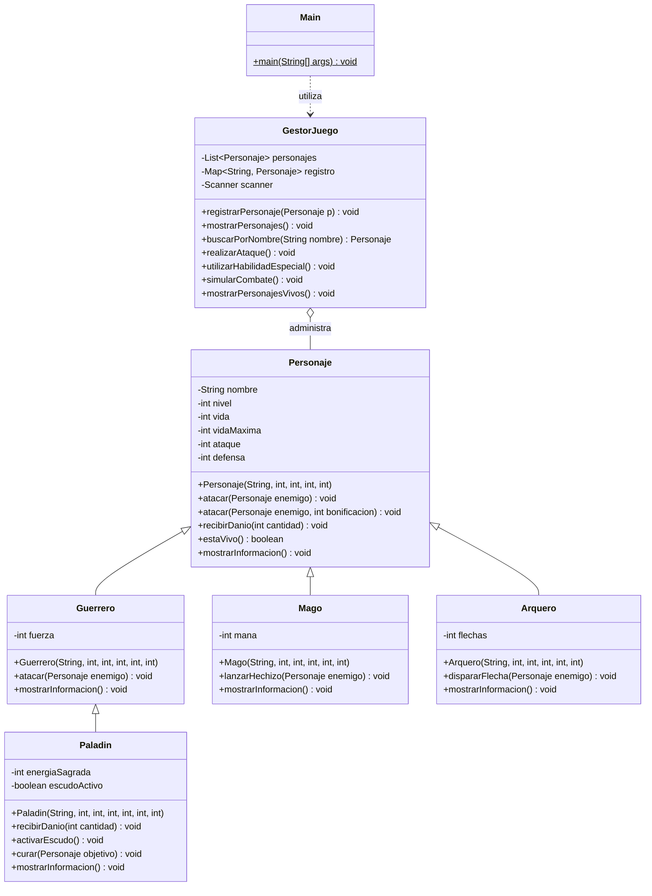

## ESFOT RPG: La Batalla de los Reinos

Aplicación de consola desarrollada en Java como tarea integradora de Programación Orientada a Objetos (POO). El sistema simula un juego de rol (RPG) por turnos que permite registrar distintos tipos de héroes, consultar sus estadísticas, gestionar sus habilidades especiales mediante polimorfismo y enfrentarlos en combates dinámicos.

## Instrucciones de Ejecución

### Requisitos previos
* Tener instalado el JDK (Java Development Kit) versión 11 o superior.
* Una terminal/consola o un IDE como IntelliJ IDEA, Eclipse o Visual Studio Code.

### Herencia en el Proyecto
El modelo evita la duplicación de código centralizando los atributos y comportamientos base en Personaje y especializándolos mediante tres tipos de herencia:  
* Herencia Simple: Se da cuando una subclase hereda directamente de una única superclase. Por ejemplo, Guerrero extends Personaje, Mago extends Personaje y Arquero extends Personaje 
* Herencia Jerárquica: Ocurre cuando múltiples clases derivan de una misma clase padre común. En este sistema, Guerrero, Mago y Arquero comparten a Personaje como su superclase directa, reutilizando sus atributos base (nombre, nivel, vida, ataque, defensa).   
* Herencia Multinivel: Se presenta en la cadena Personaje → Guerrero → Paladin. Paladin hereda de Guerrero (adquiriendo su atributo fuerza y su forma de atacar) y, de manera transitiva, hereda toda la estructura fundamental de Personaje.   

1. ¿Dónde se aplica herencia simple en el proyecto?  
Se aplica en cada relación directa de extensión entre una clase hija y su clase padre, como Guerrero extends Personaje, Mago extends Personaje y Arquero extends Personaje.   

2. ¿Por qué Personaje → Guerrero → Paladin representa herencia multinivel?  
Porque existe una cadena de descendencia de más de un nivel: Paladin extiende a Guerrero, el cual a su vez extiende a Personaje. De este modo, el Paladin integra tanto las características del Guerrero como las del Personaje base.   

3. ¿Qué relación ejemplifica herencia jerárquica?  
La relación en la que tres subclases distintas (Guerrero, Mago y Arquero) heredan simultáneamente de una única superclase común (Personaje).   

4. ¿Cuál es la diferencia entre sobrescritura y sobrecarga de atacar()?  
* **Sobrescritura (@Override):** Consiste en redefinir un método heredado en una clase hija manteniendo exactamente el mismo nombre y parámetros (por ejemplo, Guerrero sobrescribe atacar(Personaje) para sumar su fuerza al daño).   
* **Sobrecarga:** Consiste en declarar dos o más métodos con el mismo nombre dentro de la misma clase pero con diferente lista de parámetros (en Personaje existen atacar(Personaje) y atacar(Personaje, int bonificacion)).   

5. ¿Qué aporta super en constructores y métodos?  
En los constructores (super(...)), permite invocar al constructor de la clase padre para inicializar los atributos heredados sin repetir código. En los métodos (super.mostrarInformacion() o super.recibirDanio(...)), permite reutilizar la lógica base de la superclase y añadir comportamiento adicional encima de ella.   

6. ¿Por qué List<Personaje> admite guerreros, magos, arqueros y paladines?  
Gracias al polimorfismo y la relación "es-un" (is-a). Como todas esas clases derivan directa o indirectamente de Personaje, cualquier instancia de ellas puede almacenarse y manipularse bajo una referencia del tipo padre Personaje.   

7. ¿Qué versión de mostrarInformacion() se ejecuta al recorrer la lista y por qué?  
Se ejecuta la versión sobrescrita correspondiente al tipo real con el que fue instanciado cada objeto (por ejemplo, si el elemento es un Mago, muestra su maná). Esto ocurre gracias al enlace dinámico (dynamic binding) de Java en tiempo de ejecución.

8. ¿Cuándo se necesita instanceof antes de hacer casting?  
Se necesita cuando tenemos una variable declarada con el tipo genérico de la clase padre (Personaje) y queremos ejecutar un método exclusivo de una subclase (como lanzarHechizo() en Mago o curar() en Paladin). instanceof verifica el tipo real del objeto antes de convertirlo para evitar un error ClassCastException en tiempo de ejecución.   

9. ¿Qué ventaja aporta HashMap para localizar un personaje por nombre?  
Permite realizar búsquedas instantáneas en tiempo constante promedio utilizando el nombre del personaje como clave única, evitando tener que recorrer toda la lista elemento por elemento cada vez que se busca un héroe.

10. ¿Cómo se protege la consistencia de los atributos mediante encapsulamiento?  
Declarando todos los atributos como private y obligando a que cualquier lectura o modificación pase por métodos get y set con reglas de validación (impidiendo nombres vacíos, niveles en cero, estadísticas negativas o vidas superiores a vidaMaxima).

